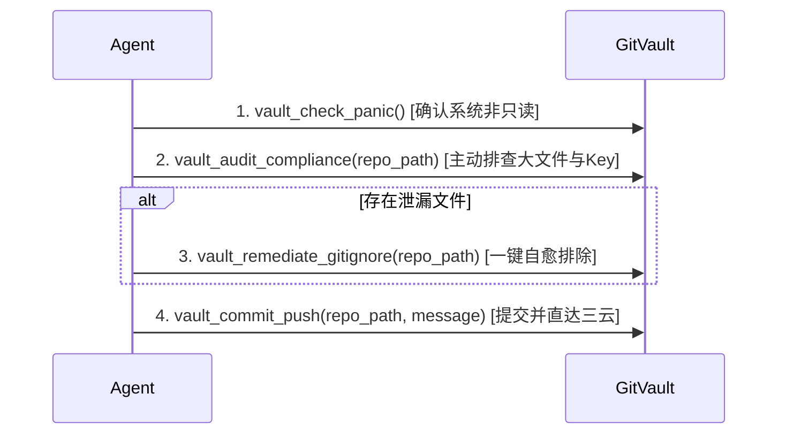

# Git-Vault Enterprise Agent Workflow Guide

本技能指导 Agent 安全、合规地使用 Git-Vault 提供的受控版本管控能力。

## 1. 核心铁律

1. **严禁在终端中裸跑 `git push`**：所有向远程的同步必须经由 `vault_commit_push` 或在控制台发起，以确保触发合规拦截与三云多路并发推送；
2. **提交前主动体检**：在进行代码提交前，优先调用 `vault_audit_compliance` 检查工作区；如发现违规敏感文件，调用 `vault_remediate_gitignore` 自动自愈；
3. **检索开源项目优先查本地 Star 库**：当用户询问开源工具、Agent 技能、Cloudflare 模板或学习资料时，优先调用 `vault_search_stars` 检索用户已收藏的 17 个仓库与 Lists，避免臆造不存在的外部库；
4. **零明文特权调用**：如需调用 Cloudflare、OpenAI 等三方接口，调用 `vault_proxy_api`，严禁向用户索要或在代码中硬编码任何 API Key。

## 2. 标准提交工作流 (Safe Commit Workflow)

## 3. 常用工具清单

- `vault_list_repos`: 扫描工作区所有仓库状态与多云同步健康度；
- `vault_get_diff`: 安全读取未提交代码变更；
- `vault_commit_push`: 执行合规代码提交并推送到 GitHub, Gitee, GitLab；
- `vault_audit_compliance`: 扫描敏感凭据与体积超限文件；
- `vault_remediate_gitignore`: 自动写入 .gitignore 并解除跟踪；
- `vault_search_stars`: 精准检索 Star 容灾库中的开源项目；
- `vault_query_lists`: 获取当前 8 个自定义分类 Lists 清单；
- `vault_star_repo`: 代表用户在云端点亮 Star 并分类；
- `vault_proxy_api`: 零明文安全调用第三方 API。
